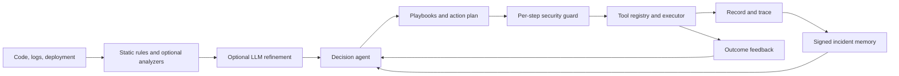

# Architecture

CyberLLM separates input analysis, decision making, action planning, and guard
checks. The Python modules live under `CyberLLM/`; the existing script entry
points remain the public way to run the application.

## Defense flow

The code scanner merges regex, optional Bandit/Semgrep, and model findings with
deterministic findings taking precedence on duplicate matches. Logs and topology
have their own deterministic analyzers. The decision agent aggregates findings,
tags assets, selects a response tier, and can use prior signed incidents.

The action engine builds typed plans from playbooks and optionally adds
model-selected tools. Its executor handles conditions, guard checks, retries,
verification, rollback, and reporting. The pipeline can re-plan after unsuccessful
outcomes up to the configured limit. Dry-run execution returns simulated results.

## Attack-modeling flow

Deployment graph discovery and source/topology exploit analysis feed the attack
orchestrator. It chooses findings, a target asset, and poison/trigger paths. The
ethics guard checks scenario/target scope and filters known destructive patterns
from generated script text. The pipeline records scripts without executing them.
The web simulation endpoint uses model reasoning or an offline explanation.

## Module responsibilities

| Location | Responsibility |
| --- | --- |
| `pipeline.py` | Load configuration/rules; orchestrate defense, attack, batches, and CLI output. |
| `server.py` | Local HTTP routing, web scanning/remediation, attack simulation, benchmark evaluation. |
| `llm_client.py` | Provider selection, `.env` loading, stub responses, provider adapters. |
| `agents/base_agent.py` | Input provenance, findings, agent results, prompting, delegation, token accounting. |
| `agents/*scanner.py`, `log_analyzer.py` | Source, deployment, and log analysis. |
| `agents/decision_agent.py` | Response tiers, asset tags, memory recommendations, re-plan feedback. |
| `agents/action_engine/` | Plan types, playbooks, generator, executor, registry, concrete tools. |
| `agents/action_generator.py` | Compatibility import for the action engine. |
| `agents/security_guard.py`, `ha_judge.py` | Contextual action/step/trajectory checks and model-assisted alignment. |
| `agents/memory_store.py` | SQLite persistence, HMAC verification, recall, outcome recommendations. |
| `agents/attack/` | Passive discovery, exploit modeling, plan selection, ethics checks, script templates. |
| `tools/static_analyzer.py` | Code/log/topology rules, external analyzer adapters, merging. |
| `reporting/findings.py` | Rule titles, source locations, and detailed finding records. |
| `run_logger.py` | Per-run metadata, prompts, findings, decisions, tool audit, summary, trace. |
| `skills/` | Declarative response and attack skill catalog. |
| `webapp/index.html` | Interface markup. |
| `webapp/assets/` | CSS and classic JavaScript, served through explicit asset routes. |

## Compatibility boundaries

`pipeline.py` still exports the finding helpers used by existing callers.
Application configuration, rules, data, and output locations remain unchanged.
The web interface uses the same API requests and classic-script execution order.
There is no JavaScript build tool or package installation step.

The web server caches configuration/rules on import and serializes scans with a
lock because some orchestration state is process-global. This is a local research
application, not a multi-tenant service. See [SECURITY.md](../SECURITY.md).

The original research mapping is preserved in [research.md](research.md).
